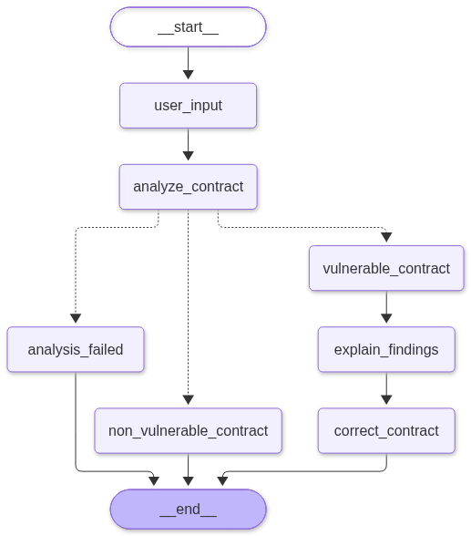

# SecureSmart Agentic AI

SecureSmart is a smart contract security analysis project that integrates Slither static analysis with an LLM-powered workflow built using LangGraph.

The system analyzes Solidity smart contracts, extracts potential security findings, and uses the Groq API to generate explanations and suggest possible code improvements.

## Overview

Traditional static analysis tools can identify potential issues in smart contracts, but interpreting their output can require security knowledge. This project explores how an LLM can complement static analysis by making reported findings easier to understand.

The workflow combines Slither for vulnerability detection and Groq for interpreting the analysis results.

## Architecture



The workflow consists of the following stages:

1. **Contract Input:** Accept Solidity source code for analysis.
2. **Static Analysis:** Execute Slither to inspect the contract.
3. **Finding Extraction:** Extract detector information, including severity, confidence, description, and source locations.
4. **Conditional Routing:** Route the workflow based on the analysis outcome.
5. **LLM Analysis:** Pass structured findings to Groq for explanations and mitigation suggestions.
6. **Code Improvement:** Generate suggested corrections based on the original contract and analysis results.

## Implementation

### LangGraph

LangGraph manages the execution flow through individual nodes and conditional edges. It maintains the contract and analysis information in a shared state.

### Slither

Slither performs static analysis on Solidity source code. Its JSON output is parsed to extract structured detector findings.

### Groq LLM

The Groq API is used to interpret Slither findings and generate explanations in natural language. The model is also used to suggest possible improvements to the contract.

## Tech Stack

- Python
- LangGraph
- Slither
- Groq API
- Solidity
- python-dotenv

## Project Structure

```text
SecureSmart-Agentic-AI/
│
├── secureScan.py
├── SimpleStorage.sol
├── securesmart_workflow.png
├── requirements.txt
├── README.md
└── .gitignore
```

## Setup

### Prerequisites

- Python 3.10 or later
- Solidity compiler compatible with the contract pragma
- Groq API key

### 1. Clone the repository

```bash
git clone https://github.com/Latikesh22/SecureSmart-Agentic-AI.git
```

### 2. Create a virtual environment

```bash
python -m venv venv
```

Activate it on Windows:

```powershell
.\venv\Scripts\Activate.ps1
```

### 3. Install dependencies

```bash
pip install -r requirements.txt
```

### 4. Configure the Solidity compiler

Install and configure `solc-select` if required:

```bash
pip install solc-select
solc-select install 0.8.20
solc-select use 0.8.20
```

### 5. Configure environment variables

Create a `.env` file in the project root:

```env
GROQ_API_KEY=your_api_key
GROQ_MODEL=your_available_model
```

Do not commit this file to the repository.

### 6. Run

```bash
python secureScan.py
```

## Limitations

- Slither findings require manual interpretation and verification.
- Static analysis may produce false positives or miss certain vulnerabilities.
- LLM-generated explanations and code suggestions are not guaranteed to be correct.
- Generated code should be compiled, tested, and independently reviewed before use.

## Copyright

Copyright (c) 2026 Latikesh Pachpute.
All rights reserved.

This repository is published for portfolio and demonstration purposes.
No license is granted for reuse, modification, or redistribution
of the source code without prior permission.

## Author

**Latikesh Pachpute**

[LinkedIn](https://www.linkedin.com/in/latikesh-pachpute-02949b176/)